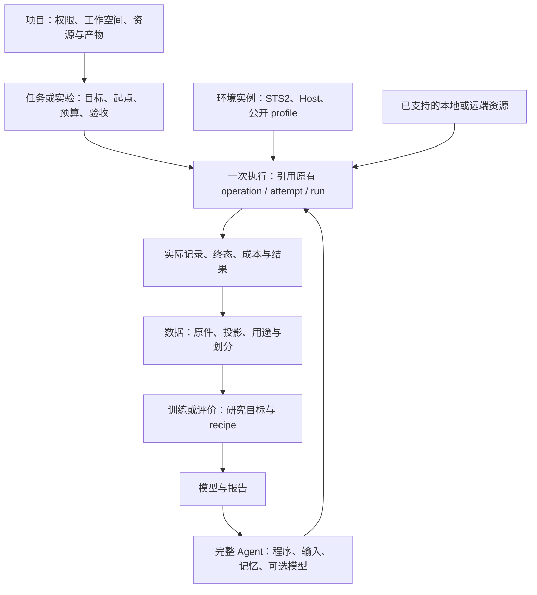

# 项目最高层架构审计：共同系统、兼容组合与未完成的整合

审计日期：2026-10-11。源码基线 `b7274c87524804f0092c2ef44dd541e158e538d6`，
仓库 `rsgcsg/STS2-The-Perfect-Defect-Project`。负责人核对实际调用路径、两份独立
源码审查和外部一手资料。这里审计顶层对象、职责与新旧接入，不重新授予运行、
Human、研究或完整 G2/V1 资格。具体原始运行、包及检查见
[本轮交付记录](../plans/BASELINE_BOUNDARY_REGRESSION_ROUND_2026-10-10.md#current-supervisor-round-2026-10-11)。

## 判断

**目前是一套共同权威和应用服务支撑的系统，承载多个语义不同的 Agent／环境组合。
新旧集成已经真实发生，但顶层任务、Agent 选择和结果表达还没有完整收敛。**

不能因为有两个运行分支就判断为两套平台；也不能因为共用仓库、界面或启动函数，
就宣布完全统一。已经共享的是真实服务和状态所有者；尚未统一的包括部分产品能力、
结果解释及生命周期实现。继续发展时，确有分化为多套产品流程的风险。

当前合理方向是保留有语义依据的差异，修复共同用例的实际断点。没有证据支持现在
推倒重建、强制迁移全部 wire、重命名全仓，或另建一个通用调度平台。

## 最高层抽象是什么

最高层不是技术模块的串联，而是：**一个项目组织任务；每次执行选定完整 Agent、
环境、起点与资源，产生有来源的运行、数据和结果；研究利用合适的数据产生新的模型，
再组成 Agent 接受评价。** 用户可以只运行、记录、分析或训练，不必走完整条链。

图表示逻辑关系和目标用例，不表示这些关系已经全部可从一个产品接口查询。
也不要求每个框都有独立服务、数据库或新的状态机。

| 顶层对象 | 应回答的问题 | 当前实际落点与完成程度 |
| --- | --- | --- |
| Project | 属于谁，使用哪个工作空间和服务 | `ProjectConfig`、Application、Hub 权限；本地配置不是通用项目调度器 |
| Task／Experiment | 做什么，何时结束，怎样验收 | 已有 TaskSpec、experiment artifact、训练请求；跨阶段关联视图不完整 |
| Agent | 谁取得信息、维护状态、决定和行动 | Manifest／可信 adapter／task／program 组合已存在；产品入口仍偏向 Model |
| Model | 哪个计算结构、参数、输入输出 | 独立 Model artifact、codec、权重及来源；不是完整行动个体 |
| Environment | 在什么世界、信息和动作规则下运行 | 具体 Host、实例、Connector profile 与起点；不同 profile 不自动等价 |
| Run／Attempt | 这一次实际发生了什么 | Runtime run、训练 attempt、Host episode、Hub call 各有身份；需要关联而非强行同号 |
| Resource | 在哪里执行，需要什么、花多少 | 已有本地 CPU、Host 和特定 Hub compute；一般多 Host 放置尚未实现 |
| Data／Artifact | 原件是什么、如何派生、可以怎样使用 | 共享 Manifest／store／index／use owner；原件、用途和可重建索引职责不同 |
| Training／Evaluation | 用什么目标学习，结果是否有用 | 共同本地训练 owner 加特定 recipe；机械完成、训练拟合与策略质量分开 |

“Task”当前还用于 `NativeTasks` 的游戏准备桥接，它不是上述通用任务调度器。
这些名称的不同含义应在界面和结果中说明，不能通过新增一个同名服务掩盖差异。

## 哪些已经真正统一

Application 创建共同的模型服务、导出、注册和训练服务。Public M0、Public M2、
native M2 的已注册选择使用同一私有 selection registry、session／进程所有者和控制入口；
`LocalModelService._start` 启动同一个 Runtime CLI。CLI 根据已声明 Manifest 选择
generic Policy 或 native Agent-session 分支。它们共用生命周期基础类和 Connector
控制权威，均不能自己制造原生合法动作。

数据与训练并非另起一套：模型、Run、checkpoint 仍使用共享 artifact 基础设施，
本地训练通过一个 `LocalTrainingService` 和可信 recipe 接口执行。不同的投影、
模型计算和训练目标属于研究实现，允许不同。

主要源码：
[Application 组合](../../python/spireagent/workbench/developer_server.py)、
[可信 Agent 入口](../../python/spireagent/workbench/trusted_agents.py)、
[共同模型运行服务](../../python/spireagent/workbench/local_models.py)、
[注册服务](../../python/spireagent/workbench/local_model_registration.py)、
[Runtime CLI](../../components/policy-runtime/src/cli.ts)、
[共同生命周期基础](../../components/policy-runtime/src/runtime-owner.ts)、
[本地训练服务](../../python/spireagent/workbench/local_training.py)。

这证明接入具有实质性，不证明所有 GUI 路径已验收，也不证明所有控制状态转换只实现一次。

## 新旧到底差在哪里

环境合同和 Runtime—Agent 程序端口是两个不同边界。前者定义公开信息、动作和失败
含义，后者定义运行器与 Agent 如何交换输入、消费进度和指令。

| 完整组合 | 环境与输入 | 程序端口／循环 | 模型或程序的实际区别 |
| --- | --- | --- | --- |
| Public M0 | `snapshot-1`，原 public 表示、完整 C，`reads=[]` | decision-only NDJSON1；generic Runtime | 无 learned carry；原完整评分与 chooser；可显式组合 ready-summary Task 和奖励选卡程序 |
| Public M2 | `snapshot-1`，compact public 表示、完整 C，`reads=[]` | decision-only NDJSON4；generic Runtime | 原 segment／ordinal／重复缓存／W 更新和 reset；不能换成新采样历史仍称原行为 |
| native structured M2 | `native-logical-v1`；所选 InputSpec、实际采样或声明的 publication 历史 | Agent-session NDJSON1；native Runtime 分支 | Consume／ACK、Query、Act、Await、Close；结构化计算和消费规则不同 |
| model-less Teacher | 声明的 native profile、固定取得与选择程序 | 同一 Agent-session 和 Runtime owner | 没有学习模型；当前 collect-only 工具可用，尚非共同产品目录中的普通选择 |

恢复旧模型复用了原参数、表示，并在已检查的固定样本／序列上核对数值行为；它不是迁移到新 native 模型。
同一权重加入奖励选卡程序，形成不同 Agent 组合。后续评价必须同时标明 Agent、
Model、Task、环境与输入历史，不能把固定程序的改善记成模型学会了策略。

必要差异应保留：macro 与分步操作、真实浏览与冻结读取、M0 无记忆与 M2 carry、
旧 ordinal 与新 occurrence／ACK、必需评分与可选评分、不同训练投影和目标。
这些语义改变不能由“adapter”一词隐去。

## 已证实的缺口与风险

### 1. 共同任务结果没有接全：近期优先修复

`local_models.py` 的普通 `_evaluation_handoff` 主要从 text-menu 事件提取终局，
`_terminal_screen` 也只接受 text-menu schema。Public M2 已有完整
`public_decision_input` 原件，共同报告却不解释它。Public M0 的 ready-summary
程序返回通用弃权，Port1 没有同样的完整决策输入事件；普通弃权不能证明任务完成。

因此，模型已经运行，用户却仍可能需要私有审计来判断是否完成任务。当前保守
unknown 没有造假，但它是产品整合缺口。修复属于应用结果投影及必要的原始见证，
不属于 Connector 合法性，也不应该靠界面猜日志。

下一增量先复用已验证原件，分别表达任务完成、预算等截断、失败、未知以及实际
胜负观察和策略评价。M0 缺少的旧见证继续未知；若需要新见证，在 owning 合同中
明确新增，不回填历史，也不把 Receipt 当作因果后继。

### 2. 共同生命周期仍有重复：真实维护风险，尚非当前故障证明

`RuntimeLifecycleOwner` 共用串行、epoch、取消和预算；generic `runtime.ts` 与
`agent-native-runtime.ts` 仍分别管理部分 held、taint、release 和终止状态。
这不表示两个控制器同时持权，但同一种修复可能只进入一个分支。

先用现有忠实夹具核对共同 Stop、deadline、release-unknown 行为；下一次真实重复
修复再抽取语义相同的部分。直接合并两大循环可能破坏不同的观察历史和 ACK 语义。
当前 stale、后继等待和策略失败必须各自按原始证据诊断，不能用重复代码作为原因证明。

### 3. Public M0 身份范围过宽：已存在的升级成本

`public_m0_policy_installation.code_digest` 仍复用全部 STPD、SpireAgent Python
和 lock 的保守摘要；无关应用修改也改变消费者身份。Public M2 已有显式消费者闭包。
严格拒绝身份漂移是合理的，过宽范围却会反复触发安装和选择协调。

合适改进是版本化的、经审查的依赖闭包：无关编辑不漂移，renderer、codec、scorer
和真实依赖修改必漂移。原 selection、权重和来源保持原义。不能直接改旧 hash 或
删除 lock 校验；native 包的依赖兼容仍需具体旧／新数值和来源证据。

### 4. Model 中心的入口尚不能完整表达 Agent

可信目录支持 learned native adapter，但没有普通产品路径选择 model-less Teacher。
Public 注册还组合默认 Task，普通 Register 请求没有完整展示这些选项。
不同 Model family 的安装、导出和准备分支也散落在共同服务中。

应优先在现有目录和 readiness 中显示完整 Agent 组合及支持范围，使模型可选、
Task／program 可辨识。只有实际需要 Teacher 产品用例时才接入；不再建另一套
AgentService，不开放任意下载代码执行，也不为了名称统一重写全部文件。

### 5. 下载与本地 Public 模型路径不一致：源码可见的能力缺口

`LocalModelExport._source` 对 downloaded structured／native Model 使用下载 reader，
Public M0/M2 则回到当前 research workspace。准备接口可下载模型，并不代表该模型
在缺少本地训练 workspace 时可导出、登记或推理。本轮本地 d6／17eb 没有验证这一用例。

若交付要求跨机器使用 Public 模型，应扩展已有的授权 artifact resolver，并区分
模型推理许可、血缘验证和原训练资料可用性。缺少许可或必要父对象时给具体原因；
不能自动导入训练资料、自动授权或绕过 use owner。

### 6. 任务与资源还不是通用可执行层：保持范围诚实

本地训练、模型运行、导出、managed Host 和 Hub 各有自己的 operation／attempt
与日志。这些记录有不同权威，不应合成一个万能数据库；当前缺的是按用户任务
关联与查看它们的共同视图。已有 artifact 血缘不能说成不存在。

`spireagent.compute` 的 provider 接口仍依赖 STPD `ComputeRequest`，后者仅接受
features／training；本地 typed training 仅公布 local-cpu。它是有用的专用 seam，
尚不能称为已实现任意本地／云端任务的统一资源调度。

先在现有能力描述中诚实公布差异。真正需要第二类 placement 或非研究 workload 时，
再提取小型共享执行封套，保留领域验证和现有 ledger。当前不建设通用 scheduler。

## 外部实践怎样校准这个判断

- [Cockburn 的原始 Ports and Adapters 文章](https://alistair.cockburn.us/hexagonal-architecture)
  按应用对话目的划分端口，允许 UI、测试和批处理复用同一应用。可借鉴语义边界和
  可替换入口；一种 wire 并不是统一系统的必要条件，多建抽象层也不会自动防止耦合。
- [RLlib 的核心对象](https://docs.ray.io/en/latest/rllib/key-concepts.html)
  区分实验组织、EnvRunner、计算 Module 和 Learner。可借鉴运行个体、模型与训练的
  分离；这不构成本项目迁移 Ray、增加集群或套用默认学习算法的理由。
- [Gymnasium Env](https://gymnasium.farama.org/api/env/)
  明确区分自然终止和外部截断。这里借鉴结果含义；实时 STS2 的输入投递和异步效果
  不能硬套成已证明因果的同步 step，预算停止也不能叫自然整局完成。

外部资料提供比较标准，不证明本仓库正确。最重要的本地检验仍是：相同用例是否走
共同 owner；新增 Agent 是否需要复制产品流程；一个 Stop 修复是否覆盖相关 driver；
是否能从共同入口解释这一次运行为什么结束；数据和模型是否能按声明权限复用。

## 收口后的行动顺序

1. 封存本轮真实运行与失败，完成当前源码检查、审查和 PR 交付。自然完成和策略能力
   尚未达成的部分保持开放，不能借架构审计宣布通过。
2. 优先诊断当前实际游戏阻塞，并补共同任务结果能力；二者可在清晰接口下并行，
   不等待通用资源或全仓重构完成。修复先有原始反例和 owning 合同。
3. 降低已证实的消费者身份和产品组合成本；按真实复用需求处理 Public 下载路径。
4. 用有足够覆盖且用途清楚的数据做策略学习和评价。保留本轮数据审计的角色与机制覆盖限制；
   不能用重命名 split、增加训练步数或更多合法投递数制造充分的独立评价。
5. 只有新任务证明需要，才扩资源放置与跨阶段关联；持续清理已不用的兼容分支，
   但保留历史原件和仍被实际消费者使用的合同。

本报告给出的是可检查的架构判断与下一步排序。source/test、具体包／安装、运行、
训练拟合、策略质量和完整 G2/V1 各自验收；只有用户能批准最终 G2/V1。
