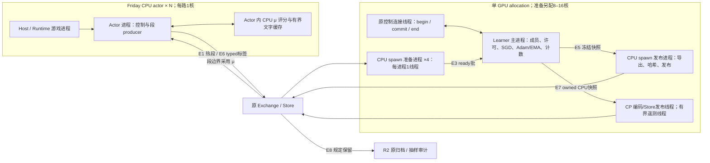

# RL Actor—准备—Learner（Managed，A0 Defect）

RL4.1 沿原 Actor、Exchange、Runtime、Evidence、Store 和归档入口接线。
actor 默认在 Friday CPU 本地评分；CPU 进程准备完整批，learner 只负责数值更新、发布 μ 和保存 CP。
长训运营由 `watch.py mode=segments` 调原 `rl.py launch/learn`，统一预算、故障停止、补位及全局5%门；
直接 `launch/learn` 只提供资源/学习接点，不启动全局运营观察者。短段Actor默认不按局部unknown计数停机。
本页拥有接口和操作方式；实际派工、预算、候选身份和验收由 [CURRENT](../../docs/memory/CURRENT.md)
指向的当轮任务负责。源码/CPU fixture 通过不代表真实 World、部署、GPU 性能或模型实力通过。

## E1–E8 的合同、实现状态和选择

只用四种实现状态：默认（唯一）、临时（写退出条件及收口时点）、备选（写当前使用方/条件和选择规则）、只读（只读旧数据）。不用的实现移除，必要时从 Git 取回。
组件承载角色，部署位置不另生业务链。E1/E7/E8 的含义变化由 RL4.1 卡授权；
E3 是准备角色从训练中细分，其他边在原合同内替换实现。

| 边 | requires → provides；失败含义 | 实现状态 | 开关 / 唯一入口 |
|---|---|---|---|
| E1 打局→段 | Runtime 确认的 completed directive、真实 successor、同 μ 全分布及尾值、原件 fsync 承诺 → ≤64 行单 μ 热段；未知动作不入段 | **默认**：Exchange 本地 `.rl-hot/<run>/<generation>`，准入不等待 archive；自然终局尾段仍等待 typed 终局 | `LearnerConfig.segments`；`SegmentManagedExecutor` → `put_hot_segment` → commit |
| E1 历史编码 | 原完整 artifact/input pack → 原历史内容 | **只读**：segment v1/v2 reader；逐段上传/压缩/复制后准入已移除 | `managed_segment_store.read_segment`；旧 writer 拒绝 live 发布 |
| E2 推理 | 公平公开输入、完整 catalog、冻结 μ → scores 与51类分布；不判合法性 | **默认**：actor CPU μ、1线程、μ 内有界文字缓存 | `segments.central_scoring=false`；`LocalMuScorer`，actor loopback 统一服务 Agent 和 producer |
| E2 中央实现 | 同上 | **临时**：中央不可变 μ 集合、合批，CUDA 固定独立高优先 stream；退出条件：RL5 收卡时仍无两卡计划就退役。当前工程测试显式使用；当本地推理加到本卡100核仍喂不满GPU时，按实测比较同一卡的中央评分；没有自动 fallback | `segments.central_scoring=true` → `create_segment_inference_pool`；attachment `role=learner_central` 使 actor 选择 `RemoteMuScorer`；CPU 可作该实现的小测 |
| E3 段→ready | 准入热段、已验 aux、固定成员/随机顺序/配置的minibatch切点 → 完整参数无关 PreparedBatch | **临时**：CPU spawn 进程、整批 advantage 和 targets、完整 forward/loss 元数据；退出条件：I1 合入 develop 时转默认，旧主线程准备移除 | `BatchPreparer.submit`；`preparation_workers=4`、`preparation_threads=1`；`prepare_ahead=true`；`prepared_bytes=1GiB` 约束当前+下一批 |
| E3 历史输入 | 原 artifact/compiled input pack → 不可变 wire | **只读**：有界 SegmentInputs LRU；同 key 只有一个冷填充 owner，读验/等待均在共享锁外 | `SegmentInputs`；新热段不依赖 pack/cache 恢复 |
| E4 更新 | `stage_batch` 一次后的完整批 → θ/Adam/EMA 更新及成功 uses | **默认**：整批 loss，4 minibatch × 1轮；按行 `segment_update` 仅拒绝旧调用 | `prepared_update`；每组 forward→整 minibatch 分母的 loss→backward 累加，全部组后只作一次 finite/KL/clip/Adam 决定；默认1轮，配置可调整，KL刹车结束剩余轮次；benchmark 与 application 同接口 |
| E4 执行选择 | 同上 | **默认**：整组 BF16 eager、无 checkpoint；**备选**：显存不足时只缩小同一实现的物理组，或不支持 BF16 的已授权 CPU 语义检查显式选 FP32 | 正式 profile 的 cap512、scene area `2^32`、text area `2^36`；G0真实320行一组峰10.44GiB，FP32峰17.60GiB；compile无稳态收益，live `compile_loss=true`明确拒绝，checkpoint重算实现已退役 |
| E5 发布/采用 | 更新后完整 θ 快照 → 完整 model+heads μ；段边界采用，旧尾值仍用旧 μ | **默认**：CPU 后台导出/哈希/Store 发布，跳过未发送中间版；默认 actor 按 grant 按需装载 | `_schedule_publication`；`SegmentGrant.mu`；当前/旧尾值显式 retain/release；临时中央实现在后台复制冻结模板和装载设备 |
| E6 标签 | Evidence 验证的真实终局或稳定 reward 的公开 HP → typed 标签及 exact RowRef | **默认**：Evidence-owned live verifier+绑定；全量二次 replay 仅抽样审计/评估 | `LiveGlobalReplay.verify(expected)` → 原 typed 入口；不是 observer 副本授权；审计失败追加 finding+Stop |
| E7 CP | 构造、θ/heads/text、完整 Adam/参数组次序、EMA、计数、Python/Torch/CUDA RNG → 自包含 CP | **默认**：`checkpoint_state.SCHEMA`；无恢复 parent，不读旧 queue/aux/输入日志；mid-epoch重放恢复已移除 | 配置 `resume_checkpoint`；新 `training_generation`；只恢复学习状态，旧热代追加丢弃处置 |
| E7 旧 CP | 真实 CP16 + 原构造包/参数次序 → 同学习状态转换 CP；转换零 SGD/World | **只读**：旧 schema `stpd/rl-segment-checkpoint-1`；显式 `convert_cp16`，没有隐式 fallback | application `--convert-cp16-package`；转换序号16、正常下一次保存17、首次新 μ58；转换和恢复 generation 各自具名 |
| E8 保留/归档 | 开 World 前冻结 seed/selection/manifest hash → 普通自然 win/loss 抽约5%原件，其余留账；技术、unknown、异常、censored、评估全留 | **默认**：`audit_every=20`，原有 full_peer 保存/后台审计按规则调用；所有训练段全归档已移除 | `managed_retention.training_audit_selected`；原 native+behavior 原件全部规定读回后才释放本轮新副本，旧资产不扫描清理 |

历史 `segments.inference_stream` 字段只读；当前实现选择由 `central_scoring` 决定，
中央 CUDA 固定独立 stream。已移除共用训练锁/默认 stream 的中央评分，以及 forced null 分布再由 learner 补算的分支。

## 进程、线程和质量预算



一张表按 E1–E8 记吞吐、延迟、host/显存和磁盘；行/h必须写清 R（含强制）还是成功首用多选D。
正常 progress 的 `first_use_policy_bias` 把**成功首用多选行**的完整 KL(μ‖πθ)、选中动作比率和
裁剪观测，与 optimizer 尝试开始时的数据年龄、发布版本差和 SGD 更新差逐行对应后分桶。
只持久化固定直方图边界、计数与和，窗口汇总可相加；分位数由合并后的直方图报区间近似，
不能平均每批分位数。缺时间、负年龄及非有限值分别计数，forced、aux、多轮重复使用不进首用分母。
`outside_clip` 是比率越界，`ppo_objective_clipped` 还按 advantage 方向判断；`ratio_above_one`
只是 rho_bar=1 的反事实比例，未实施 V-trace。旧抽样近似 KL 与反向 `acting_kl_theta_mu` 字段不改。
观测复用原 forward、只传小型 detached 行统计，并入原单次 pre-step D2H；不改 loss、uses、准入或年龄门。
下列带日期数字是原测量，不能升级为当前G1实测；本轮准确SHA、原收据和预算由CURRENT指向的报告拥有。

| 边 | 吞吐 / 延迟 | host / 显存预算和已有实测 | 长期磁盘增长 |
|---|---|---|---|
| E1 生产/准入 | 64步段；旧R2单路0.350s/R，仅估算起点；G1报实际段到达与等待 | actor/Host分别量峰RSS；GPU0 | 普通局5%原件；其余留账，技术失败全留；G1量MB/h |
| E2 评分 | 报forward+D2H的P50/P95及μ文字缓存命中；不是端到端单步耗时 | CPU模型/文字缓存每actor有界；中央实现另量显存 | μ包随版本增长，不能称全盘有界 |
| E3 准备 | W1原1024行2.78–2.93s；G1量连续不同dataset与等待 | 4进程各自量RSS；current+next共`prepared_bytes=1GiB` | 热段最后引用释放；原不可变账本另算 |
| E4 SGD | G0真实1024+128+128的320行minibatch：BF16热0.514s、FP32热0.906s | 整组BF16峰10.44GiB allocated/11.94GiB reserved；FP32峰17.60GiB；G0进程峰4.48GiB RSS；PreparedBatch158.13MiB | SGD本身无持久增长 |
| E5 发布/采用 | 报snapshot、后台导出发布和段边界采用分别耗时；未发中间版可跳过 | 逐进程RSS；后台CPU不保存live GPU图 | 每版model+heads、导出副本各算MB/h |
| E6 aux | 默认每dataset终局128、HP128；只计实际存在和成功使用的行 | pool按局/战斗数有界；PreparedBatch包含所选aux | typed标签/账本增长单列，不能由池有界推全盘有界 |
| E7 CP | 默认900s；保存/恢复分别量，G1短验可显式缩短 | 量snapshot、编码/发布期间RSS与节点数；原修后CP编码峰669MiB是独立CPU诊断 | 原CP约85MB，900s约340MB/h；新CP以实际字节和次数算 |
| E8 归档/审计 | 后台量选中、完成和等待，训练路径不等待全局replay | 保存worker/磁盘积压另量 | 规定全留+5%原件+不可变CAS；实测增长并估剩余可跑时长 |

容量统一换算成成功首用多选/h时，actor用实测R/h×多选比例×首用率；GPU用实际dataset的多选数/全轮SGD时间。
准备/SGD/发布可重叠，不能相加当总墙钟；整链吞吐取瓶颈。
先在≤100 actor核内喂GPU，再比较组大小/精度；100核仍喂不满才比较E2中央实现。
报告15万、30万和最快配法时区分实测与外推；G0局部0.514s不等于在线15万/h已经通过。

## 内存与物理批形状

`microbatch_size`限制物理encoder组；scene/text area仍可能先把组缩小。
G0的真实320行组，scene为`[320,1123]`、文字`[2048,128]`，旧4行area使整批碎成80次forward。
正式profile用cap512及足够area，让通常的256 PPO+32 terminal+32 HP在一组中完成；整段溢出仍按实际形状分组。
显存不足只缩小同一实现的组：每组forward→loss→backward累加；全组共享分母，最后一次裁剪、KL/finite决定和Adam。
不保留所有encoder图、不重算forward。诊断先累加四头梯度向量再求范数/夹角；不能把组范数相加充当全批范数。

学习状态在 `_learning_state` 冻结为owned CPU bytes；`encode_state`只展开dataclass元数据，
不对共享slab每个Tensor做deepcopy。schema/codec及θ、Adam、EMA、RNG和恢复计数不变。
峰值按进程及阶段报告，区分RSS、CUDA allocated/reserved和nvidia-smi采样；不能把不同时间的高水位相加当同时常驻量。

## 一个正式配置和生效开关

唯一出发点是仓库`python/configs/rl41.json`。普通运行JSON声明`"profile":"rl41"`，补run、peer、原CP、
新generation、rendezvous和资源时限；各section的显式值覆盖该profile，最后仍是原`LearnerConfig`。
`learn --actors N`与转换的`--actors N`都冻结`capacity_rows=dataset_rows+N*steps`；
正常`learn`把生效参数写入`work/learner-config.json`，plan同时绑定原请求和生效文件的hash。
至少需要`ceil(dataset_rows/(episode_rows//steps*steps))`路：默认8路，steps48/episode128需11路。
原episode份额按pending+inflight共同限额，避免最快一局填满global容量却永远凑不齐dataset。

lr、四头系数、熵、clip/KL、λ、minibatch/轮数、aux行数与成功复用上限、段长和EMA均由配置消费；
范围/类型检查不强制卡上的某个数。默认仍为卡上1024、4×1、aux128/128与2/1、λ.99，文字可训练、Z-next关闭。
多轮只增加成功使用次数，first_use只记第一次；aux按每epoch预备mask，达到配置use_limit的行后续轮次不再贡献loss，
对应head分母也同步变化。auxiliary_rows0关闭抽样。KL刹车不记uses并结束该dataset剩余轮次，不靠重复补到目标次数。
γ1是当前原生终局类别目标的含义；γ<1如何表示折扣目标须先明确，不能给分类概率直接乘γ或假称新字段已生效。
实际effective配置保存在CP及正常summary，改方法值在本轮收据中明确报告；旧CP只读，正常恢复仍核方法配置一致。

| 选项 / 状态 | prepared训练的实际行为 |
|---|---|
| **默认**：microbatch/scene area/text area、deduplicate_text、precision、tf32 | 六个字段实际参与CPU组形状、文字去重或learner精度；生效配置只导出这六项 |
| **只读**：packed/tensor_cache/joint_nodes | 历史row路径选择；prepared固定用完整tensor/joint元数据，不用它们选另一训练实现 |
| **只读**：device_cache/reference_device_cache/async_transfer/precompile_inputs | 历史row/reference输入缓存；prepared统一stage完整slab一次，无这些训练开关 |
| **只读**：bucket/defer_sync | 历史row重排/同步选项；prepared已固定整批partition和一次pre-step决定，不读取它们 |
| **只读**：inference_microbatch_size/probe_inference_microbatches | 历史推理诊断；actor执行由μ construction及central_scoring决定，不是prepared训练参数 |
| 已退役：compile_loss=true、activation checkpoint重算 | G0 compile热0.515s对eager0.514s，冷编30.79s；live明确拒绝true。checkpoint只保留历史配置/收据，源码只有逐组累加一种实现 |

## 冻结身份和 μ

Actor 的 CPU scorer 固定 1 个算子线程和 1 个 interop 线程，并关闭 Torch 的 MHA
融合推理快路径，使用普通 SDPA 路径；同输入实测的选择与整路收益分别报告。
这项进程级设置只在本地 CPU scorer 创建时应用，不改变独立 learner 或中央 CUDA scorer。
Actor summary 的 `local_mu.mha_fastpath` 记录实际开关；选择包含在 adapter 的源码身份中，
采用新源码须重新发布对应 μ，不热换正在运行的旧组合。

临时中央评分复用每个 Actor 自己的一条认证评分连接，policy 与 forced/尾值调用串行；
控制连接保持独立，容量许可等待不会挡住 commit。新 generation 的 grant 会关闭旧评分连接，
下一次请求按原 rendezvous 连接；未知或协议错误的评分先废弃连接，只重连读取 status，
不重送原 score。Actor 关闭时释放连接。这不构成中央 GPU 吞吐或几百路容量资格。

μ 仍是完整 model 包及独立 `stpd/rl-behavior-heads-1` checkpoint；snapshot hash 绑定
weights、heads、projection、adapter 和数值配置。`export.adapter_identity()` 的代码闭包包含
`local_mu.py`。文字可训练；缓存 namespace 随实际 μ、文字权重和输入身份变化，不把文字冻结作加速。
clock offset 沿 Agent 实测的 `{lower, upper}` bounds 或 null 传递，不把区间伪装成单个 offset。

HotSegment 没有 Artifact schema。commit 的 `payload` 是 `HotPayloadRef(slot,sha256,size)`；
`segment_artifact_id="hot:"+slot` 仅是消费者位置，禁止交给 Store 或 CP parents。
Delayed outcome/HP 都使用 `source={run_id,segment_id,training_generation,row,key}`。
`HpBattle.post_hp` 是原公开绝对 HP，行 `hp=post_hp/100`；reward 变体带实际
boundary acquisition、step、input hash 和战斗范围，native terminal 变体由 typed 终局绑定。
不能用 max_hp、下一场战斗状态或未确认的非战斗输入代替标签。

## 容量、失败和引用

ready、在途 lease 共用按路数冻结的 `capacity_rows=dataset_rows+actors*steps`；每批至少1024行，保留整段溢出行，
单 episode 每数据集最多128行。PPO、延迟标签、aux、prepare、reader 各自持有 hot owner；
各 payload 的归属修改通过固定256个锁条带并行；普通修改共持代际读锁，恢复独占整代后才撤销引用。
这避免 NFS 上所有准备 worker 与 actor 争一把排他锁；不改变引用计数、原件或 unknown 的含义。
commit/episode_end ACK 前取得下游所需引用，用尽或淘汰释放，最后引用才删除本轮临时热 bytes。
每个数据集抽样的 aux 终局≤128行、最多2次且跨2个数据集；HP≤128行、1次/1个数据集。
常驻池是另一口径：terminal最多256局、每局均匀抽最多64行；HP最多128场战斗，
每场行数随原件变化，128行/批不是整个HP池的行数上限。

输入 ACK 是原输入及完整 response 的不可变事实。ready、used、discarded_on_restore 都是后续处置，
不改旧 accepted/unknown。断线先查原 receipt；原结果未知时不盲重投。
明确新代且原请求不存在，旧 commit/episode_end 只追加丢弃；同一 World 通过新 begin 领新代 lease，
不重新 offer seed。尾段写入撞上已撤销的旧热代也追加丢弃，不改成 unknown 或 accepted。
关局或actor终态后，尚未准备的PPO段仍可能带跨段HP回填；此前段的delayed引用保留到同局PPO
均交接给标签reader，再按真实引用释放。关局不等于所有标签已消费，也不补造终局标签。

## 启动、CPU 短测和只替换 learner

正常应用：`python -m spireagent.workbench.rl_learner --config learner.json --work <fresh-work>`。
Friday 入口仍是 `tools/friday/rl.py learn`，只在 Slurm 分配和原 resource-slot 内运行；
`device=cpu` 可做已授权短测，`device=cuda` 沿原 GPU 分配。actor 数与 inference_batch 解耦，1–500路；
CPU 单路短测同时设小 dataset/episode_rows，不能用默认1024行的最少8路条件冒称单路通过。
使用 `rl.py prepare/submit/run/save` 原 actor 入口、完整原件保存和收据；unknown 不重试。

配置固定 `segments.rendezvous_path` 为原启动的共享 inference.json。launcher 把此路径交 actor，
learner 把完整新 attachment 原子写回同一路径；环境 capability 保持在原环境中，不写文件或日志。
`rl.py prepare` 将当时的 attachment 原字节另存到各 actor plan 目录并绑定 hash；共享发现路径
供下一代连接使用，不能作为旧计划的不可变引用。新代更新发现路径后，旧计划仍能正常核验和查账。
恢复前停止并确认旧 learner/prepare/SGD 已结束，保留 actor/World 和原件；新 work 目录、同一 run、
新 generation、同一 peer/rendezvous/capability，从指定自包含 CP 启动。
恢复撤销该 CP 所属旧热代，追加 discarded_on_restore；旧 ACK 仍可查。不要同时启动两个 learner。
`episode_open` 的成功 ACK 带实际 run/generation；actor 按 episode 保存这个准入归属，
恢复后的重新准入在等待新 lease 之前更新。producer 用该归属持久化 close，不能用启动 attachment
或最后一条旧段猜代。旧 receipt 只读、不回滚归属；当前 episode close 释放该 World 各代的本地 μ 引用。
当前代零段时只收口控制，不附 terminal/outcome/HP 训练标签；原 typed World 结果仍完整保留。
观察线程和收口 tail 的第一个错误以 type/stage/code/errno 留在原 report/私有诊断，
后来的 reconciliation 错误不覆盖它，不保存原 SDK 消息或连接地址。

旧 CP16 转换先准备一个正常 learner JSON：同原 run、原 CP16 ID、目标新 generation，
明确本轮 peer/资源和学习参数，再运行：

```sh
python -m spireagent.workbench.rl_learner --config learner.json --work conversion \
  --convert-cp16-package /ABS/original-construction-package \
  --source-generation g-legacy --conversion-generation g-converted --actors 32
# 零 SGD/World；输出 conversion-receipt.json 和 converted-learner.json。
python -m spireagent.workbench.rl_learner --config conversion/converted-learner.json --work fresh-learner
```

原构造包只在显式转换时需要；自包含 CP 正常恢复不需要它。转换保留原非空 Adam 动量、参数顺序、EMA、RNG、
362 updates / 48951 first-use / 42787 multi / μ57；新参数差异写在转换记录中。
显式转换按目标配置改写两组 lr（主干 lr、heads head_lr）及 weight_decay，并记录实际参数组；
普通自包含 CP 恢复仍原样恢复参数组。progress 的 lr/head_lr 和 summary 的 optimizer_param_groups
均读实际 optimizer，不以配置值代替。
转换成功不自动证明真实打局恢复；须新段→成功更新→新 μ采用→新 CP→只换 learner→继续更新。

## 验证和停止点

语义反例使用 CPU 测：TD/λ/终局/HP、非终局 bootstrap、同 μ forced/尾值、完整 catalog、
代际隔离、CP-only 与 unknown 不重投。重要跨线候选作非作者复核。
加速可改变批次/精度/实现，不设逐位或容限等价门；G1看整循环速度、KL/熵/clip/各头 loss 和常数基线，
GPU throughput、真实 World、健康小时及实力结论各用其原实测。CPU fixture 不替这些结论。


### 规模化保留与正常调度

本轮已批准的大路数档使用 execution 中原 `retention.audit_every=100`（约1%），
小规模沿20（约5%）；这是按开局身份哈希抽样，不是每小批强制抽一局。
launcher、Actor、producer 和保存复核共用原 retention 配置，ledger 收据记录实际模数。
未抽中的自然训练局走 ledger_only，不调用 native 原件的发布、归档或完整读回；
段/控制账本、模型、CP 仍各按原 Store 归档。censored、unknown、技术失败及评估仍完整保留。
共享 Store 的现有归档线程只由一个进程持有 OS 锁并扫描全局待存队列，继续接手死亡进程的孤儿任务；
其他进程按自己的既有 owned 集合复制，不反复遍历全队列。进程退出释放锁后由存活线程接手。
普通 drain 与它声明的 owned 范围一致；显式全局 drain/恢复入口保持，逐条锁、不可变发布和完整读回不变。
同一队列优先按原 input index 的 run/generation 路径和补零序号服务，再处理其余原 intent；
避免从随机 SHA 根反复遍历尚未发布的长 previous_input 父链。这只改变服务顺序，不应用/重放输入。
原20模数的历史记录不重算、不改写。

Friday submit 复用原容量函数和原 smp 调度；普通打局/评估默认仍用 idle 核的四分之一、上限200。
短段 RL 按已批准的规模开放至500路，可用全部实际 idle 核，排队超过300项仍降至32路；
实际路数与资源授权仍由本轮任务及 GAME-SLOT 决定，代码上限不构成开局授权。
submit 校验完整计划；每个已分配 actor 只校验自己的固定配置与共享 execution/inference/learner 绑定。
短段 worker 在 World 之前把已 pin 的完整 bundled Runtime（含 SDK/zod）物化到 node-local 缓存；
源、私有 staging、命中副本均走原 Runtime 包验证，不放宽协商或 Evidence 身份检查的超时。
缓存按包内容 SHA 隔离并单写入发布，actor 使用私有派生配置；原计划/配置保持，snapshot 留原/派生 hash 收据。
副本不随单 actor 退出删除；原共享安装仍是长期恢复入口，节点外读回须提供同 pin 的可信代码位置。
同一 worker 随后物化完整 Host 包、candidate（含自包含 `.git` 和实际 lib 字节）、游戏目录、
Node 可执行文件与 .NET SDK；按原路径/Host pin/游戏 assembly pin 隔离，一次 staging 后原子发布。
原/副本相对路径、字节和模式一致；命中时在发布锁外核本地树及原 Host pin，避免串行大 hash。
子进程使用本地 Host/candidate/game/Node/.NET 和独立 CLI 缓存；原 Actor 构造与每局 Host
candidate 审计仍照常执行，不缓存审计结论。完整原/派生配置、闭包大小/hash 与耗时归原 snapshot。
Python 源/环境、模型、Hot/Archive、rendezvous 和输出仍走原 owner；可变控制事实不冻结进节点副本。
共享 inference 每次读取一次，避免 N 路各重读 N 份完整词表配置，造成平方级启动开销。
11-05 I1 原约594核只允许约148路的旧限制已被本轮500路授权替代；旧128/256未offer的事实不改。

长训的预算、恢复、固定评估、容量与CP保留入口见[原长训指南](RL_LONG_RUN.zh-CN.md#rl41-长训运营入口ops-候选集成后使用)。源码检查、CPU实际恢复和GPU/H1资格分开报告。
